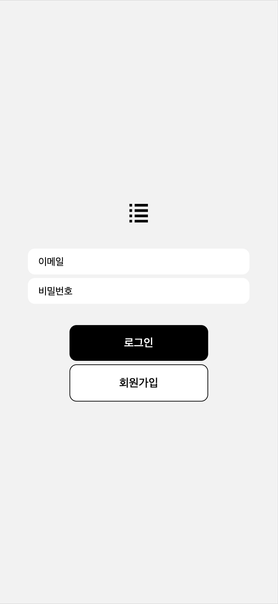

# React Native Todo App

React Native(Expo)로 만든 할 일 관리 앱입니다.
Firebase Authentication으로 회원가입·로그인을 처리하고, Redux Toolkit으로 할 일 목록의 상태를 관리합니다.

<p align="center">
  
  &nbsp;&nbsp;
  
</p>

## 프로젝트 정보

| 항목 | 내용 |
|---|---|
| 기간 | 2024.09 ~ 2024.12 (리더스플러스 멘토링 팀 프로젝트) |
| 참고 강의 | 인프런 「따라하며 배우는 리액트 네이티브 기초」 |
| 개발 환경 | Expo SDK 50, React Native 0.73 |
| 사용 기술 | React Native, Redux Toolkit, Firebase Authentication, React Navigation |

## 주요 기능

- **회원가입 · 로그인 · 로그아웃**: Firebase Authentication의 이메일/비밀번호 방식을 사용합니다. 로그인 상태가 되면 메인 화면으로 이동합니다.
- **할 일 추가**: 입력창에 할 일을 쓰고 `+` 버튼이나 엔터로 추가합니다.
- **완료 처리**: 체크박스를 누르면 '완료된 일' 목록으로 이동하고, 다시 누르면 '할 일'로 돌아옵니다.
- **삭제**: 오른쪽 삭제 버튼으로 항목을 지웁니다.

## 폴더 구조

```
├── App.js                  # 화면 이동(Login → Main)과 Redux Provider 설정
├── firebase.js             # Firebase 초기화, auth 객체 내보내기
├── screens/
│   ├── LoginScreen.js      # 이메일·비밀번호 입력, 회원가입·로그인 처리
│   └── MainScreen.js       # 할 일 / 완료된 일 목록, 로그아웃
├── components/
│   ├── InputForm.js        # 할 일 입력창과 추가 버튼
│   └── TodoItem.js         # 할 일 한 줄(체크박스, 내용, 삭제 버튼)
├── redux/
│   ├── store.js            # Redux store 생성
│   └── slices/
│       └── todoSlice.js    # addTodo · updateTodo · deleteTodo 액션
└── assets/                 # 체크박스·삭제·목록 아이콘(SVG)
```

## 동작 방식

**Redux 상태 관리**
- 할 일 목록은 `todoSlice`의 `todos` 배열에 저장됩니다. 각 항목은 `id`, `text`, `state('todo' 또는 'done')`를 가집니다.
- `MainScreen`은 `useSelector`로 목록을 가져와 `state` 값에 따라 '할 일'과 '완료된 일'로 나눠 보여 줍니다.
- `InputForm`과 `TodoItem`은 `useDispatch`로 추가·완료·삭제 액션을 보냅니다.

**Firebase 로그인**
- `createUserWithEmailAndPassword`로 회원가입, `signInWithEmailAndPassword`로 로그인합니다.
- `onAuthStateChanged`로 로그인 상태를 감지해 메인 화면으로 이동하고, `signOut`으로 로그아웃합니다.

## 실행 방법

```bash
npm install
npx expo start
```

터미널에서 `w`를 누르면 웹 브라우저에서, `i`를 누르면 iOS 시뮬레이터에서 실행됩니다.

## 기록

- 2024.09 ~ 12: 리더스플러스 멘토링에서 강의를 따라 Todo 앱 구현 (화면 구성, Redux 상태 관리, Firebase 로그인)
- 2026.10: 코드 오류 수정, 패키지 버전 정리, Firebase 로그인 재구현 (기존 코드 유실)
